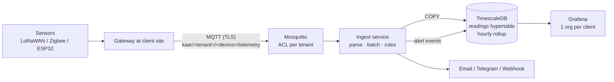
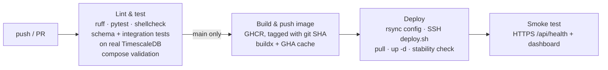

# Kaar Monitoring – sensor monitoring as a service

[](https://github.com/AlainAhuili/kaar-monitoring/actions/workflows/ci-cd.yml)
**Live demo:** https://demo.kaarsmarttechs.com (read-only dashboard, simulated bakery freezer with an incident every 6 h)

Starter platform for Kaar Smart Techs: business sensors (cold storage, server rooms,
leaks, energy) → MQTT → TimescaleDB → alerts + Grafana dashboards, one system for many clients.

## Architecture



**Why these choices**
- **MQTT + one topic per device**: what every gateway (Milesight, Dragino, ChirpStack, ESP32) can speak. With LoRaWAN, ChirpStack's MQTT integration is reshaped into this topic format by a small bridge or a gateway-side script.
- **Narrow readings table** `(time, device_id, metric, value)`: any new sensor type works with no schema change. TimescaleDB compresses it heavily after 14 days (about 10–20×); retention defaults to 2 years.
- **A single worker thread in ingest**: ordered rule evaluation and no DB locking. A small VPS handles a few thousand messages per second, far beyond what a few hundred battery sensors send (about 1 msg/min each).
- **Rules in the database**: change thresholds without redeploying. They are reloaded every 60 s.

## Data model

```
tenants (client company, slug used in MQTT, db_role for Grafana)
 └─ sites (buildings)
     └─ devices (external_id from topic, offline_after_s, last_seen)
          └─ readings (hypertable)          readings_hourly (continuous aggregate)
alert_rules (scope: device | site | whole tenant; metric, > or <, threshold, hysteresis, duration, severity)
alert_events (threshold/offline, started_at, resolved_at, peak_value, acknowledged_*)
notification_channels (per tenant: email | telegram | webhook, min_severity)
```

## Alert semantics

| Concept | Behaviour |
|---|---|
| **Duration** | Fires only after the value has been breached continuously for `duration_s` (e.g. door opened for 2 min ≠ alarm). |
| **Hysteresis** | Resolves only when back past the threshold by `hysteresis`, which prevents flapping. |
| **Peak** | Worst value during the incident is stored. Useful for reports ("max −8.3 °C for 26 min"). |
| **Offline** | No message *received* for `offline_after_s` → offline alert. Based on arrival time, so a gateway uploading buffered data doesn't trigger it. This also covers "sensor died while in breach". |
| **Restart-safe** | Open events are reloaded at startup; unique indexes prevent duplicate events and duplicate notifications. MQTT uses a persistent session (QoS 1) so messages are queued while ingest restarts. |

## Multi-tenancy and security

- **MQTT**: each client's gateway gets a user named after the tenant slug. The ACL (`pattern write kaar/%u/+/telemetry`) means it can only publish into its own tenant. Unknown devices are dropped and logged, so devices must be provisioned first.
- **Client dashboards**: each client gets a Postgres LOGIN role (member of `grafana_tenant`) that can only read the `tenant_*` views, filtered by `current_user`. In Grafana: create an org per client, add a datasource with that client's role, and build dashboards on `tenant_readings` / `tenant_readings_hourly` / `tenant_alert_events`. Even a hand-written SQL query can't see another client's data.
- The provisioned Grafana datasource deliberately uses the demo client's **read-only role**, because Grafana viewers (including anonymous visitors of the public demo) can send arbitrary queries to a datasource. Only the ingest service uses the `kaar` owner role; admin work goes through `docker compose exec db psql` or an SSH tunnel.

## Run it (dev)

```bash
cp .env.example .env              # set passwords
set -a; . ./.env; set +a
tools/mqtt_user.sh ingest "$MQTT_INGEST_PASSWORD"
tools/mqtt_user.sh baeckerei-demo "$MQTT_DEMO_GATEWAY_PASSWORD"
docker compose --profile demo up -d --build    # 'demo' profile = simulator container
docker compose logs -f ingest                  # see [CRITICAL] ... then [OK] ...
```
Grafana: http://localhost:3000 → *Kaar – Sensor Overview* (admin login with `GRAFANA_ADMIN_PASSWORD`).
The simulator replays the last 3 h (including a freezer incident) and then keeps sending in real time.

Payload format the gateways must send:
```json
topic: kaar/baeckerei-demo/freezer-01/telemetry
{"ts": "2026-11-03T20:00:00Z", "metrics": {"temperature": -18.4, "humidity": 61, "battery": 97, "door_open": false}}
```
`ts` is optional (ISO 8601 with timezone, or epoch s/ms; up to 7 days back is accepted for buffered uploads).

Tests: `pip install -r ingest/requirements.txt -r ingest/requirements-dev.txt && cd ingest && pytest`
(DB integration tests run when `DATABASE_URL` / `TENANT_DATABASE_URL` are set, as in CI).

## CI/CD

`.github/workflows/ci-cd.yml`:



- Every image is tagged with the commit SHA. **Rollback** = *Actions → CI/CD → Run workflow* with `image_tag` = an older SHA (skips the build, redeploys that image).
- The `production` GitHub environment can require manual approval before deploys (Settings → Environments).
- `deploy.sh` fails the pipeline if the ingest container isn't stable 15 s after the rollout.

## Deployment (Hetzner, about €5/month)

One-time setup, about 30 minutes:

1. **DNS:** two A records, e.g. `demo.kaarsmarttechs.com` and `mqtt.kaarsmarttechs.com` → server IP.
2. **Server:** Hetzner Cloud → Ubuntu 24.04, CX22, location Falkenstein/Nürnberg. Paste `deploy/cloud-init.yml` (with your SSH keys) as *Cloud config*. Optionally add a Hetzner Cloud Firewall with 22/80/443/8883.
3. **Deploy key:** `ssh-keygen -t ed25519 -f gh-deploy -N ""`. The public key goes into cloud-init; then run `ssh-keyscan <server-ip>` for known_hosts.
4. **GitHub repo settings:**
   - Secrets: `DEPLOY_HOST` (IP), `DEPLOY_USER` (`deploy`), `DEPLOY_SSH_KEY` (contents of `gh-deploy`), `DEPLOY_KNOWN_HOSTS` (ssh-keyscan output)
   - Variables: `DOMAIN` (`demo.kaarsmarttechs.com`)
   - Environment `production` (optional: required reviewers)
5. **On the server, once** (`ssh deploy@<ip>`):
   ```bash
   cd /opt/kaar && nano .env      # copy .env.example, set strong passwords + DOMAIN, MQTT_DOMAIN, ACME_EMAIL
   ```
   Push to `main`. The first pipeline run copies the files, then stops at "mosquitto/passwd missing". Then run:
   ```bash
   cd /opt/kaar && set -a && . ./.env && set +a
   tools/mqtt_user.sh ingest "$MQTT_INGEST_PASSWORD"
   tools/mqtt_user.sh baeckerei-demo "$MQTT_DEMO_GATEWAY_PASSWORD"
   ```
   and re-run the workflow.
6. **GHCR image visibility:** after the first build, make the package public (GitHub → Packages → package settings), or run `docker login ghcr.io` on the server with a read-only PAT.

A real gateway or ESP32 then connects to `mqtts://mqtt.kaarsmarttechs.com:8883` with its tenant credentials.

**Schema changes:** `db/init` only runs when the database is first created. For changes after go-live, add a migration tool (e.g. dbmate) and a migration step in `deploy.sh`.

## Production checklist

- [x] MQTT over TLS on 8883 (Let's Encrypt via Caddy), internal 1883 not published; Grafana only behind Caddy with HTTPS
- [x] Postgres never published; public dashboard uses a read-only tenant role
- [x] SSH keys only, firewall, fail2ban, unattended upgrades (cloud-init)
- [ ] Strong, unique passwords per gateway
- [ ] Nightly `pg_dump` (or pgBackRest) off-site, and test a restore once
- [ ] Monitor the monitor: an external uptime check (e.g. UptimeRobot on `https://DOMAIN/api/health`) + an alert if ingest logs stop (the `stats` line comes every 5 min)
- [ ] Choose the retention period per client contract (what they must be able to show an inspector or auditor)
- [ ] Hosted in an EU data centre (e.g. Hetzner) and covered by a data processing agreement (AV-Vertrag) with each client

## Next steps

1. **Monthly PDF report per client** (min/max/avg per device from `readings_hourly`, list of incidents with peak and duration). This is the deliverable restaurants and care homes pay for.
2. **Alert acknowledgement** link in emails (`acknowledged_at/by`) plus escalation if not acknowledged within X minutes.
3. **Small admin UI** for onboarding (tenant, site, devices, rules, channels) instead of SQL.
4. **ChirpStack bridge** for LoRaWAN sensors → this topic format.
